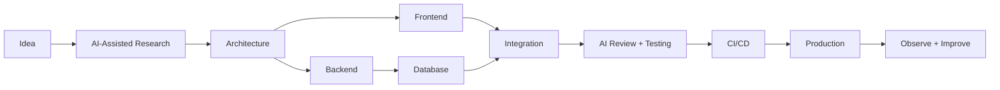

<div align="center">


<br/>

# 👋 Hi, I'm **Arshia Sadrrezvani**

### AI-Powered Full-Stack Web Engineer · Frontend · Backend · DevOps

I build complete web products end to end, combining full-stack engineering with AI-assisted research, debugging, architecture, automation and rapid prototyping.

<p>
  <a href="https://github.com/HMCisHere"></a>
  
  
</p>


</div>

---

## 🧠 About Me

```ts
const arshia = {
  role: "AI-Powered Full-Stack Web Engineer",

  frontend: [
    "JavaScript", "TypeScript", "React", "Vue.js",
    "Next.js", "HTML5", "CSS3", "Responsive UI"
  ],

  backend: [
    "Node.js", "Python", "PHP", "Elixir",
    "REST", "GraphQL"
  ],

  data: ["PostgreSQL", "Redis"],

  devOps: [
    "Linux", "Docker", "Kubernetes", "Nginx",
    "GitHub Actions", "CI/CD"
  ],

  superpower: "AI-augmented software engineering"
};
```

I work across the full product lifecycle, from interface design and frontend architecture to backend services, APIs, databases, DevOps and deployment.

What makes my workflow different is that I actively use **AI as an engineering accelerator**: not as a replacement for understanding, but as a force multiplier for research, debugging, code review, architecture exploration, documentation, testing and rapid iteration.

---

## 🤖 AI-Augmented Engineering

> **AI is part of my toolchain, not my substitute for engineering fundamentals.**

I use AI to move faster while keeping architecture, security, validation and production responsibility under human control.

### How I use AI in real development

```text
Product idea
    ↓
AI-assisted research & requirement analysis
    ↓
Architecture & data modeling
    ↓
Rapid prototype
    ↓
Frontend + Backend implementation
    ↓
AI-assisted debugging & code review
    ↓
Security / edge-case review
    ↓
Tests & documentation
    ↓
Deployment
    ↓
Observe → Refactor → Improve
```

- 🧩 **Architecture exploration** — compare implementation strategies before coding
- 🐛 **Debugging** — reduce time spent finding root causes
- 🔍 **Code review** — detect readability, performance and maintainability issues
- 🧪 **Testing** — generate edge cases and test scenarios
- 📚 **Research** — rapidly understand unfamiliar APIs, libraries and concepts
- 📝 **Documentation** — turn implementation knowledge into usable technical docs
- ⚡ **Rapid prototyping** — validate ideas before full implementation
- 🔐 **Security review** — challenge assumptions around auth, input, permissions and data flow

---

## 🛠️ Tech Stack

### Frontend

<p></p>


### Backend

<p></p>


### Data

<p></p>


### DevOps & Infrastructure

<p></p>


---

## 🧱 What I Build

| 🌐 Frontend Products | ⚙️ Backend Systems |
|---|---|
| Responsive web applications | REST APIs |
| Modern dashboards | GraphQL APIs |
| Interactive interfaces | Authentication flows |
| Multi-role applications | Role-based authorization |
| Mobile-first web experiences | Business logic & integrations |
| PWA-ready interfaces | File and background workflows |

| 🗄️ Data & Architecture | 🚀 DevOps |
|---|---|
| Relational data modeling | Dockerized applications |
| PostgreSQL & Redis | Linux servers |
| Query optimization | Nginx |
| API contracts | CI/CD pipelines |
| Caching strategies | GitHub Actions |
| Scalable application structure | Automated deployments |

---

## ⚡ The AI-Powered Full-Stack Workflow



### My rule

```text
AI can generate code.
Engineering decides whether that code belongs in production.
```

---

## 💡 Engineering Principles

| Principle | How I apply it |
|---|---|
| `Understand First` | I don't merge code I cannot explain |
| `KISS` | Prefer simple systems over impressive-looking complexity |
| `DRY` | Remove meaningful duplication without bad abstractions |
| `YAGNI` | Build what the product needs now |
| `Security by Design` | Authentication is not authorization |
| `Readable > Clever` | Future maintainers should understand the code |
| `Mobile First` | Responsive behavior is part of the design |
| `Production Thinking` | Loading, errors, logs and recovery are real features |
| `AI With Verification` | AI output is reviewed, tested and challenged before use |

---

## 🔄 Development Workflow

```bash
git switch -c feature/new-capability

git status
git diff

git add .
git commit -m "feat: add new capability"

git push -u origin feature/new-capability
```

### Commit style

```text
feat: add authentication flow
fix: prevent duplicate requests
refactor: extract business rules
perf: optimize database query
security: enforce authorization policy
test: cover failure scenarios
docs: document API workflow
ci: automate deployment pipeline
```

---

## 🚀 Featured Work

### 🏗️ Full-Stack Web Applications

I build applications where frontend, backend, database and infrastructure are treated as one connected system rather than unrelated layers glued together at the end.

```text
UI
 ↓
API
 ↓
Business Logic
 ↓
Database
 ↓
Infrastructure
 ↓
Production
```

### 🤖 AI-Enhanced Product Development

I use AI throughout the software lifecycle to accelerate product exploration, implementation, debugging, refactoring, technical documentation, testing, research and developer tooling.

The goal is not simply to **write code faster**.

The goal is to **solve better problems faster**.

### ⚙️ DevOps & Automation

```text
Git
 ↓
GitHub
 ↓
CI
 ↓
Build
 ↓
Tests
 ↓
Docker
 ↓
Deployment
 ↓
Monitoring
```

---

## 🎓 Education

### University of Tehran
**Bachelor's Degree — In Progress**

### Urmia University
**Associate Degree — Graduated**

---

## 📊 GitHub Analytics

<div align="center">


<br/>


</div>

---

## 🏆 GitHub Trophies

<div align="center">

</div>

---

## 🧭 Current Direction

```text
AI-Augmented Full-Stack Engineering
├── Modern Frontend Architecture
├── API & Backend Engineering
├── AI Integration
├── Developer Automation
├── Scalable Data Systems
├── PWA / Web Applications
├── DevOps
└── Production Reliability
```

---

## 🧑‍🚀 My Developer Identity

```text
Frontend when the product needs polish.
Backend when the product needs logic.
DevOps when the product needs to survive production.
AI when the workflow can be made smarter.

Full-stack because the product does not care
where one developer's comfort zone ends.
```

---

## 📬 Connect

<div align="center">

<a href="https://github.com/HMCisHere">
  
</a>

<br/><br/>

### Build fast. Think deeply. Ship responsibly.

**AI-powered engineering, backed by real full-stack fundamentals.**

</div>
